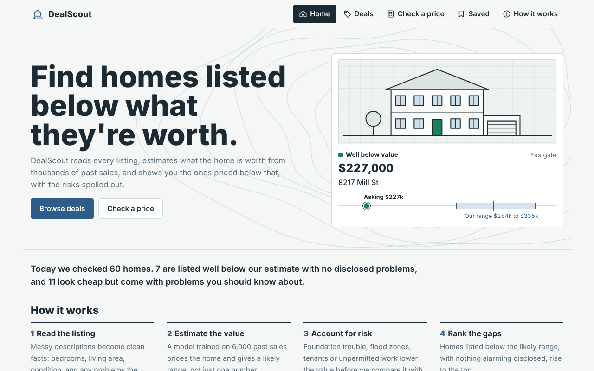
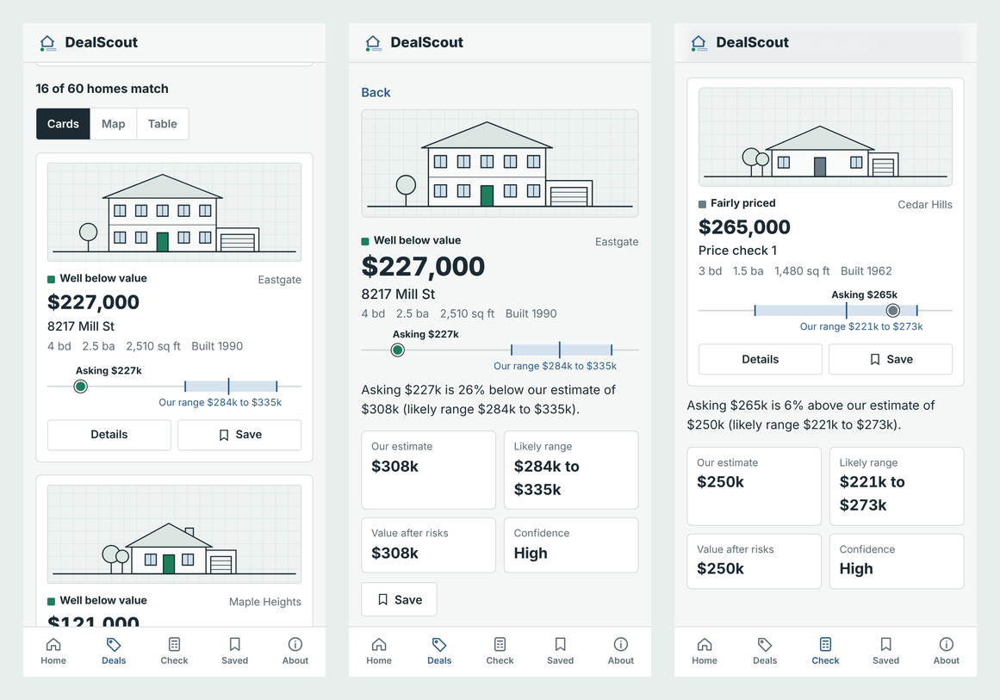
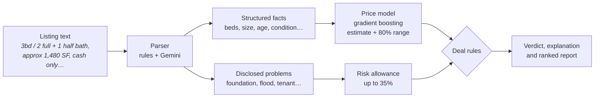

<div align="center">


# DealScout

**Find homes listed below what they're worth.**

A machine-learning price model, an AI listing parser and a deal-hunting agent, delivered as a
mobile-friendly web app.

[**Open the live site**](https://valentinakiyungi.github.io/real-estate-deal-finder/) &nbsp;|&nbsp;
[Run the full app](#getting-started) &nbsp;|&nbsp;
[How it works](#how-it-works)

[](https://github.com/valentinakiyungi/real-estate-deal-finder/actions/workflows/tests.yml)


</div>



## Why DealScout

Listing prices are set by sellers, not by the market. Some homes are listed well below what comparable
homes sell for; others only *look* cheap because the small print mentions foundation trouble, a flood
zone or a sitting tenant. DealScout reads each listing, estimates a fair value with a likely range, prices
in the disclosed risks, and tells you which is which.

- **Every estimate comes with a range**, calibrated so it contains the real sale price 80% of the time.
- **Risks are priced in, not ignored.** A home that is cheap *because* of its problems is labelled
  "cheap for a reason" instead of being called a deal.
- **Plain-language verdicts.** Every home gets an explanation such as *"Asking $227k is 26% below our
  estimate of $308k (likely range $284k to $335k)."*

## Two ways to use it

| | **Static site** (GitHub Pages) | **Full app** (Streamlit) |
|---|---|---|
| Browse deals: cards, map, table, filters | ✓ | ✓ |
| Check a price for any listing | ✓ (the model runs in your browser) | ✓ |
| Saved homes and side-by-side compare | ✓ (kept on your device) | ✓ (kept for the session) |
| Upload your own listings (CSV) | | ✓ |
| AI analyst (Gemini reads listings and drives the search) | | ✓ |
| Downloadable deal report | CSV | HTML, Markdown, CSV |
| Needs a server | No | Yes (free on Streamlit Community Cloud) |

<p align="center"></p>

## How it works



1. **Read the listing.** A rule-based extractor and, optionally, Gemini turn free text into validated
   fields (a Pydantic schema). When both run, any disagreement lowers the confidence rating. The parser
   knows not to confuse lot size with living area, converts acres, and handles "1 full + 1 half bath",
   "3.2k sq ft" and "three bedrooms".
2. **Estimate the value.** A gradient-boosted tree model, trained on log price with engineered features
   (effective age since renovation, condition for its age, an out-of-fold neighbourhood price level,
   size ratios), gives the estimate. Two quantile models, calibrated with conformal prediction, give the
   likely range.
3. **Allow for risk.** Each disclosed problem lowers the value: foundation 12%, cash-only 8%, flood zone
   7%, tenant 5%, as-is 4%, unpermitted work 4%, roof 3%, capped at 35%.
4. **Decide and rank.**

   | Verdict | Rule |
   |---|---|
   | Well below value | No disclosed problems, and at least 15% below the estimate (or below the whole range and at least 10% below) |
   | Below value | No disclosed problems, and at least 10% below the estimate |
   | Below value, has risks | Problems disclosed, but still at least 10% below the value after the risk allowance |
   | Cheap for a reason | Looks cheap, but the risks explain the price |
   | Fairly priced / Above value | Within 10% of the estimate / more than 10% above it |

The **agent** wraps these steps as tools (`search_listings`, `analyze_listings`, `get_listing`,
`submit_report`). With an API key, Gemini decides what to search and inspect and writes the report. It can
only rank homes that were actually analysed, so it can't invent listings. Without a key, a built-in
planner calls the same tools.

## Results

Measured on 1,200 sales the model never saw:

| Metric | Result |
|---|---|
| Typical error (MAPE) | **6.2%**, against 14.9% for a neighbourhood price-per-square-foot rule of thumb |
| Within 10% of the sale price | 80% of homes |
| R² on log price | 0.96 |
| Sales inside the 80% range | 82% |
| Estimate from parsed listing text | 5.4% error |
| Deal detection | 80% of real deals found; no home with disclosed problems is ever ranked as a clean deal |

The training data has about 5.6% random noise built in, so the model is close to the best possible.

## Getting started

Requires Python 3.10 or newer.

```bash
git clone https://github.com/valentinakiyungi/real-estate-deal-finder.git
cd real-estate-deal-finder
python -m venv .venv
source .venv/bin/activate          # Windows: .venv\Scripts\Activate.ps1
pip install -r requirements.txt
python -m streamlit run app.py
```

The site opens in your browser. On the first launch the model trains, which takes about 10 seconds.

### Switch on the AI analyst (optional, free)

1. Get a free Gemini key at <https://aistudio.google.com/apikey>.
2. Copy `.env.example` to `.env` and paste your key: `GEMINI_API_KEY=your-key`.
3. Restart the app. On the Deals page, open **Change listings or run the AI analyst**.

`.env` is excluded from Git, so your key never reaches GitHub. The AI parses 15 listings per request to
stay within free-tier limits, retries when rate-limited, and falls back to the built-in planner if it
times out. An `ANTHROPIC_API_KEY` also works.

### Command line

```bash
python main.py find                                   # run the agent, write reports/deal_report.html
python main.py find --neighborhood "Cedar Hills" --max-price 400000
python main.py find --csv my_listings.csv             # your own listings
python main.py parse "3 bed / 2 bath, 1,650 sq ft, built 1988, needs TLC"
python main.py evaluate                               # accuracy against the hidden ground truth
python main.py build-site                             # refresh the GitHub Pages site data
```

## Deployment

### Static site on GitHub Pages

The `docs/` folder is a complete static site: HTML, CSS and JavaScript, with the trained model exported to
JSON. The price check runs the same trees in the browser, so it needs no server and no API key.

1. On GitHub, open **Settings → Pages**.
2. Under **Build and deployment**, set **Source** to **Deploy from a branch**, then choose branch `main`
   and folder `/docs`. Save.
3. After a minute or two the site is live at `https://<your-username>.github.io/real-estate-deal-finder/`.

After retraining the model, run `python main.py build-site` and push to refresh the site. The exporter
re-scores the exported trees in Python and refuses to write them if they differ from scikit-learn. A test
then checks the browser engine against Python on 369 listings.

### Full app on Streamlit Community Cloud

1. Go to <https://share.streamlit.io> and sign in with GitHub.
2. Choose **Create app**, then **Deploy a public app from GitHub**. Pick this repository, branch `main`
   and main file `app.py`.
3. In **Advanced settings**, choose Python 3.12. For the AI analyst, add to **Secrets**:
   `GEMINI_API_KEY = "your-key"`.
4. Deploy. To link the two sites, paste the app's URL into `liveAppUrl` at the top of `docs/js/app.js`.

Visitors share your free Gemini quota, so each visitor can run the AI analyst up to three times per
visit (`AI_RUNS_PER_VISIT` in `ui/state.py`).

## Use your own data

The sample market is simulated, because listing feeds such as Zillow, Redfin and MLS need API keys and
have restrictive terms. A simulated market also has a known true value for every home, which is what makes
the accuracy figures above measurable.

- **Listings to scan:** upload a CSV on the Deals page or pass `--csv`. Only `description` and
  `asking_price` are required. Optional columns are `listing_id`, `address`, `neighborhood`,
  `days_on_market`, `lat` and `lon`. Common names such as `price`, `remarks` and `latitude` are
  recognised.
- **Train for a real city:** replace `data/historical_sales.csv` with recent sales that have the columns
  in `dealfinder/model.py` (`RAW_COLS`) plus `sale_price`, then run `python main.py train`.

## Project structure

```
├── app.py                  Streamlit entry point: theme, navigation, secrets
├── main.py                 Command line: train, find, parse, evaluate, build-site
├── dealfinder/             Core engine (no web code)
│   ├── data.py             Simulated market with messy listing text
│   ├── model.py            Feature engineering, gradient boosting, conformal ranges
│   ├── parser.py           Rule-based and LLM listing parser (Pydantic schema)
│   ├── agent.py            Deal rules, agent tools and loop, report writer
│   ├── llm.py              Gemini and Claude client (standard library only)
│   ├── services.py         Shared logic for the CLI and the web app
│   └── export.py           Model and market export for the static site
├── ui/                     Streamlit pages, components and theme
├── docs/                   Static GitHub Pages site
│   ├── index.html, css/, js/app.js
│   ├── js/engine.js        Parser, features, tree scoring and deal rules in JavaScript
│   └── data/               Exported model and analysed market
├── tests/                  20 tests, including Gemini mocks and the JS parity check
└── .github/workflows/      Runs the tests on every push
```

## Testing

```bash
python -m pytest -q
```

The suite covers the parser, model accuracy, the agent's guardrails, the Gemini adapter (function calls,
thought signatures, timeouts and rate limits against a simulated API), and the site's helpers. If Node.js
is installed, it also checks that the browser engine matches Python on every parsed field, every number and
every explanation, across 369 listings. GitHub Actions runs it all on every push.

## Design

DealScout uses a survey-drawing look: Archivo type, a cool paper background, and survey blue with one
colour per verdict. Each home is shown as a line-drawn front elevation generated from its data (wider for
more bedrooms, a second storey for larger homes, a garage, pool or chimney where they apply). Every price
appears as a **gap bar**, with the likely range as a band and the asking price as a dot. On phones, the
site uses a bottom tab bar, full-width cards and 44px touch targets.

To rename the product, change `BRAND` in `ui/theme.py` and the text in `docs/index.html`.

## Disclaimer

DealScout gives estimates, not appraisals or financial advice. Check any home with an inspection and recent
nearby sales before making an offer.
